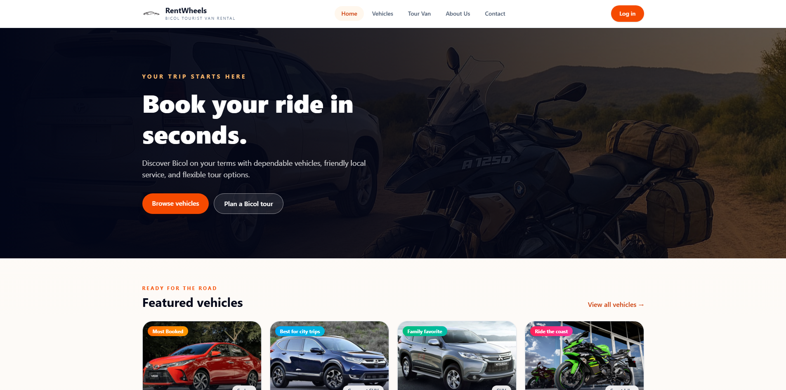
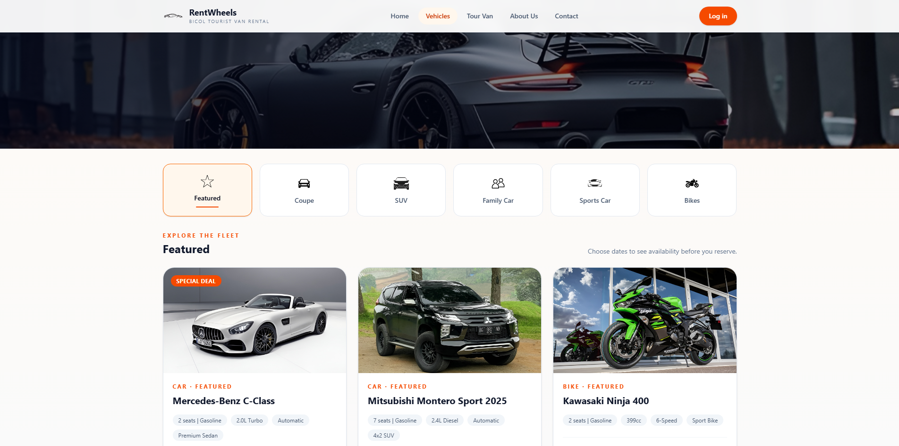
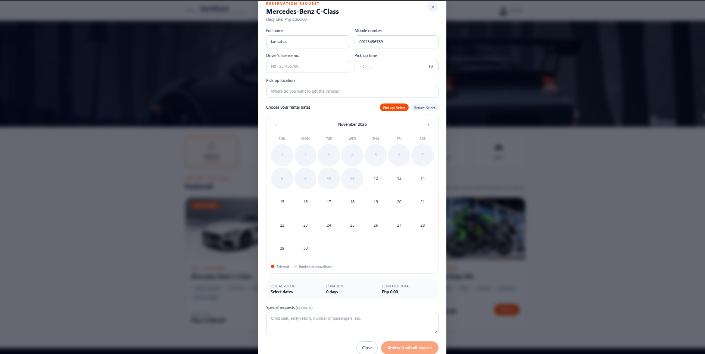
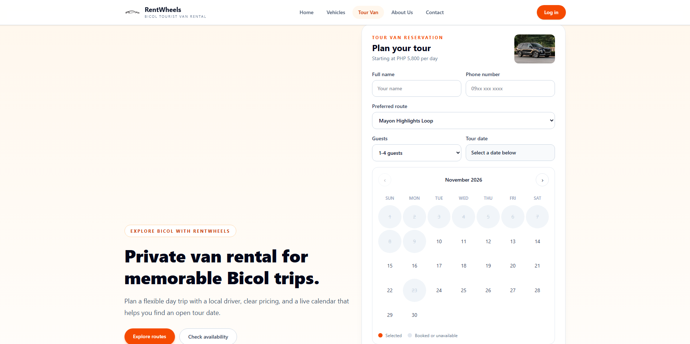
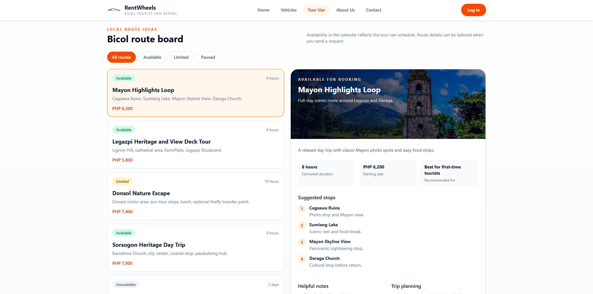
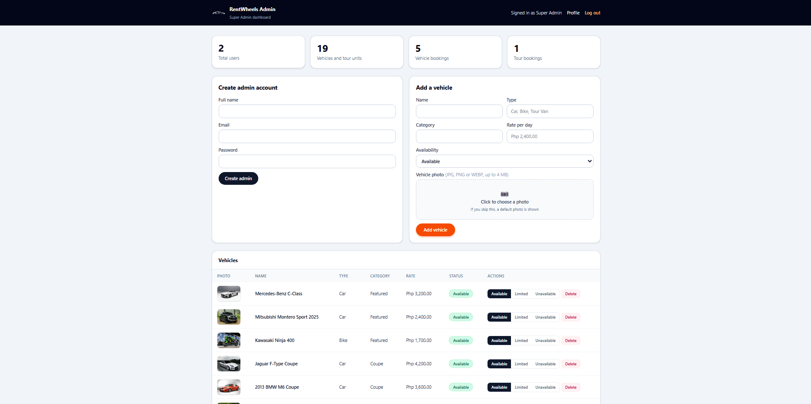

# RentWheels 
### Vehicle Rental & Bicol Tour Van Booking System

A web-based vehicle rental and tour van booking platform designed to make booking easier and more convenient. RentWheels allows customers to explore vehicles, reserve rental dates, and book tour vans for destinations around the Bicol Region.

Developed as a final project for **Systems Analysis and Design (BSIT)**.

---

## Preview
### Homepage


### Vehicles



### Tour Van



### Admin Dashboard


---

## Features

**For Customers**
- Account registration and login
- Browse vehicles by category
- Reserve vehicles with an interactive booking calendar
- Book tour vans with customizable trip details
- View and cancel personal bookings
- Manage profile information
- Submit customer reviews
- Booking confirmation before submitting requests

**For Administrators**
- Dashboard with system statistics
- Manage customer booking requests
- Approve or reject vehicle and tour van reservations
- Monitor vehicles, users, bookings, and reviews

**For Super Administrators**
- Add vehicles with photos and details
- Update vehicle information
- Manage vehicle availability
- Delete vehicles
- Set vehicle status to Available, Limited, or Unavailable

---

## Built With

| Technology | Purpose |
|---|---|
| React 18 | Frontend |
| React Router | Page navigation |
| Tailwind CSS | UI styling |
| Axios | API requests |
| Vite | Development and build tool |
| Laravel | Backend framework |
| PHP | Backend programming language |
| MySQL | Database |

---

## Project Structure

```text
RentWheels/
├── frontend/       # React application
│   ├── src/
│   ├── public/
│   └── package.json
│
├── backend/        # Laravel application
│   ├── app/
│   ├── database/
│   ├── routes/
│   ├── public/
│   └── tests/
│
└── README.md
└── screenshots
```

---

## Getting Started

### Requirements

- PHP 8.3+
- Composer
- Node.js 18+
- MySQL
- XAMPP (recommended)

### 1. Clone the Repository

```bash
git clone YOUR_REPOSITORY_URL
cd RentWheels
```

### 2. Set Up the Database

1. Start MySQL using XAMPP.
2. Open phpMyAdmin.
3. Create a database named `vehicle_rentals`.
4. Import `backend/database/vehicle_rentals.sql`.

### 3. Configure the Backend

```bash
cd backend
composer install
copy .env.example .env
php artisan key:generate
```

Configure your `.env` file:

```env
DB_CONNECTION=mysql
DB_HOST=127.0.0.1
DB_PORT=3306
DB_DATABASE=vehicle_rentals
DB_USERNAME=root
DB_PASSWORD=

SESSION_DRIVER=file
CACHE_STORE=file
QUEUE_CONNECTION=sync
```

Start the Laravel server:

```bash
php artisan serve
```

Backend URL: `http://localhost:8000`

### 4. Configure the Frontend

Open another terminal:

```bash
cd frontend
npm install
npm run dev
```

Frontend URL: `http://localhost:5173`

---

## Booking Status

| Status | Description |
|---|---|
| Pending | Waiting for administrator approval |
| Confirmed | Booking request approved |
| Rejected | Booking request declined |
| Cancelled | Booking cancelled |

---

## Running Tests

Run the backend tests using:

```bash
cd backend
php artisan test
```

---

## Project Information

| | |
|---|---|
| **Project** | RentWheels |
| **Category** | Web-Based Booking System |
| **Course** | BSIT |
| **Subject** | Systems Analysis and Design |
| **Frontend** | React + Tailwind CSS |
| **Backend** | Laravel + PHP |
| **Database** | MySQL |

---

## License

This project was developed for academic purposes.

---

**RentWheels** | Making every trip easier, one booking at a time.
